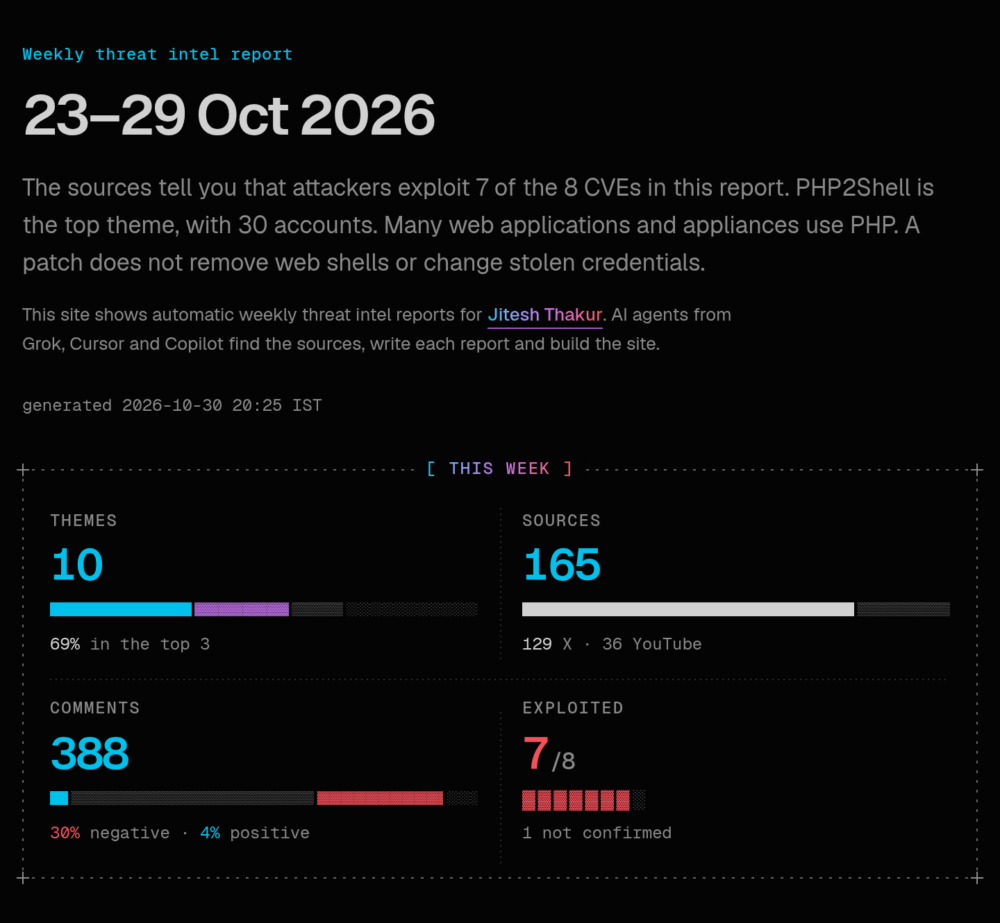
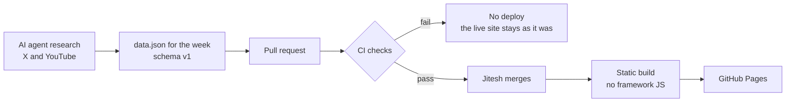

# Weekly threat intel

What security vendors, media and independent accounts said on X and YouTube, one report for each week. The report ranks the themes by how many accounts covered them, not by likes. Each CVE shows the state that the sources report: exploited, not confirmed or not exploited.

By [Jitesh Thakur](https://www.linkedin.com/in/jithamsft/). I use Grok, Cursor and Copilot. Agents write the code. CI blocks a bad week, and I merge each change.

**[Read the latest report](https://jitha-afk.github.io/gruesome-spooky-cackle/)** · [How it works](#how-it-works) · [Built with agents](#built-with-agents) · [Follow Jitesh Thakur on LinkedIn](https://www.linkedin.com/in/jithamsft/)

[](https://jitha-afk.github.io/gruesome-spooky-cackle/reports/2026-10-23_2026-10-29/)

## What each report shows

Many accounts post about the same event. The report counts the distinct accounts for each theme, so one viral post does not set the rank.

- **Themes, ranked by accounts.** Distinct accounts and channels come first, then X engagement. A chart shows how many vendors, media outlets and independent accounts covered each theme.
- **CVE states.** Each CVE that a theme cites has one of three states, from the sources: exploited, not confirmed or not exploited.
- **Key sources.** Each theme lists its key posts and videos first, with a link to each one.
- **Comments.** Replies and quote posts on the top X posts of each theme, in clusters, with sentiment. The report does not show commenter usernames.
- **Sources.** A table of every post and video in the report, most engagement first.
- **Change since last week.** From the second week, each key number and each theme shows its change from the week before.
- **Method and limits.** Each week records how the agent found the posts and what it could not read.

New reports also go to the [Atom feed](https://jitha-afk.github.io/gruesome-spooky-cackle/feed.xml). If you find an error in a report, [open an issue](https://github.com/Jitha-afk/gruesome-spooky-cackle/issues/new).

## How it works



1. **Research.** An AI agent searches X for posts from security vendors and media. Keyword searches add independent accounts. The agent also finds YouTube videos from the same week. It groups the posts into themes with keyword rules and reads the replies on the top posts.
2. **Contract.** The agent writes one file for each week: `reports/<start>_<end>/data.json`. [`data-ingestion/`](data-ingestion/README.md) defines that file with a JSON Schema and a rule for each field.
3. **Checks.** CI runs on each pull request. A test failure or a week-check error stops the build.
4. **Merge.** Jitesh merges the pull request. CI runs the same checks again on `main`.
5. **Build.** Next.js 16 exports static HTML. Then the build removes the framework JavaScript. Two small scripts remain: an inline script sets the theme and accent before the page shows, and [`public/site.js`](public/site.js), about 3 KB gzip, runs the controls. The build also draws two share images for each week and writes the Atom feed.
6. **Deploy.** A push to `main` deploys the site to GitHub Pages. If a test, the week check or the build fails, nothing deploys, and the live site stays as it was.

| Step | Command | Stops the deploy |
| --- | --- | --- |
| Unit tests for the data helpers and the ingestion rules | `pnpm test` | Yes |
| Week check: the schema, the folder name and layout risks | `pnpm check:week` | On errors. Warnings do not stop it. |
| Schema v1 and plain-English check of the weekly prose | `python3 scripts/check_schema_v1.py <file>` | No. CI shows the result and goes on. |
| Static export, then removal of the framework JavaScript | `pnpm build` | Yes |
| Built-site tests: each week and theme is on the site, no value is broken, no framework JavaScript remains, `site.js` is under 3 KiB gzip, and the share tags, share images and feed are in place | `pnpm test:site` | Yes |

The plain-English check uses rules from ASD-STE100 (Simplified Technical English). It flags sentences of more than 20 words and possible passive voice.

## Built with agents

After the first commit, each change to `main` arrived as a pull request, and Jitesh merged it. The commits name the coding agent as the author or a co-author: Cursor ("Cursor Agent") in #1–#3 and Copilot in #4 and #5.

| Pull request | What changed | Agent, from the commits |
| --- | --- | --- |
| [#1](https://github.com/Jitha-afk/gruesome-spooky-cackle/pull/1) | A Python build script and the GitHub Pages workflow. It added the week-1 report as uploaded. | Cursor |
| [#2](https://github.com/Jitha-afk/gruesome-spooky-cackle/pull/2) | A rebuild as a static Next.js site, with one `data.json` for each week. | Cursor |
| [#3](https://github.com/Jitha-afk/gruesome-spooky-cackle/pull/3) | A week built from a Markdown file and a sources file. It was closed without a merge. | Cursor |
| [#4](https://github.com/Jitha-afk/gruesome-spooky-cackle/pull/4) | A redesign, the data contract and the week checker. Four auditor agents reviewed design, motion, accessibility and mobile, and code. | Copilot |
| [#5](https://github.com/Jitha-afk/gruesome-spooky-cackle/pull/5) | Plain-English site copy, coloured numbers, the byline and the accent menu, with reviews for STE, design, accessibility and code. Open. | Copilot |

- **30 Oct 2026, 16:03 UTC.** The repository starts.
- **16:55 UTC.** PR #1 merges, 52 minutes after the start.
- **16:58 UTC.** The site goes live, 55 minutes after the start.
- **31 Oct, 10:53 UTC.** PR #2 merges: the static site and the week's `data.json`.
- **14:52 UTC.** The PR #4 redesign merges, less than 23 hours after the start.

The description of PR #4 records these results:

- The week page went from 39,733 px to 5,127 px tall at 1440 px wide. That is 87% shorter.
- axe found 0 violations in 32 states: both pages in light and dark mode at 390 and 1280 px, with sections open and closed, each tab and both phone menus.
- Contrast passes WCAG AA for every accent in light and dark mode. The one exception is the decorative `/` in the breadcrumb.
- No page scrolls sideways at eight widths from 320 to 1440 px.
- An agent wrote odd weeks to try to break the layout. Five broken weeks stopped the build, with one line for each error.

The full build story, with a link to each pull request, commit and run, is in [How agents built this](docs/how-agents-built-this.md).

## What Jitesh decided

The agents wrote the code. These choices came from Jitesh, in the pull requests and in his requests to the agents:

- **Plain English on the site.** He asked for a site that is "minimal and ASD STE 100 style". PR #5 rewrote the site copy with short sentences, active voice and one word for one thing.
- **Numbers in colour.** He asked for colour on "the stat / impact numbers". In PR #5, each number takes the colour of the mark that it counts, and red means exploited or negative.
- **An accent menu.** He asked for the accent menu next to the light/dark switch, with prism and dark mode as the defaults.
- **The credit in the README.** At his request, PR #5 moved the design credit from the site footer to this README ([a7804ca](https://github.com/Jitha-afk/gruesome-spooky-cackle/commit/a7804ca)).
- **One JSON file for each week.** He merged PR #2, which reads one `data.json` for each week. He closed PR #3, which split a week into a Markdown file and a sources file, without a merge.
- **A human merge.** He merges each pull request, and he ran the first deploy by hand.

<!-- [confirm] Add more only if they were Jitesh's decisions: the rank by distinct accounts, not likes; the JSON data contract; the GPL-3.0 licence; the research step and its agent. -->

## What went wrong

- **Pages was off.** The agent in PR #1 could not turn on GitHub Pages, because its token got HTTP 403. The first deploy failed at Configure Pages ([run 41094244405](https://github.com/Jitha-afk/gruesome-spooky-cackle/actions/runs/41094244405)). After Pages was on, Jitesh ran the workflow by hand ([run 41094681104](https://github.com/Jitha-afk/gruesome-spooky-cackle/actions/runs/41094681104)).
- **A very long page.** Before PR #4, the week page was 39,733 px tall at 1440 px wide. To reach the fifth theme, a reader scrolled past every post in the first four. The PR #4 redesign cut it to 5,127 px.
- **Two words for one thing.** The site said "brief" and "report", and "post" and "source". PR #5 kept one word for each.
- **A claim given as a fact.** The first plain-English lead, in PR #5, gave the exploitation of 7 of the 8 CVEs as a fact. The report does not check claims, so the lead now names the sources.
- **A dead end.** PR #3 split a week into a Markdown file and a sources file. It was closed without a merge.

## Limits

Each week lists its method and limits at the end of the page. For 23–29 Oct 2026:

- The report names the account that posted each claim. It does not check whether the claims are true. The agent did not open links inside posts.
- The agent did not read YouTube comments. The comments use X replies and quote posts only.
- The agent read one page of replies (25 or fewer) on each post that it sampled. Large threads are only partly in the data.
- Keyword rules assign the themes. Other keyword rules assign the comment clusters and the sentiment. These comment rules work for English only.
- YouTube view counts are a snapshot at capture time.

The site has no analytics and sets no cookies. The pages work without JavaScript. The week page loads post and video thumbnails from X and YouTube.

## Reuse this

The code is GPL-3.0. To run your own weekly report:

1. Fork the repository. In **Settings → Pages**, set **Source** to **GitHub Actions**.
2. Put your site URL, base path and repository in [`lib/site-url.mjs`](lib/site-url.mjs). Put your name and link in [`lib/site.ts`](lib/site.ts), and your byline in [`components/header.tsx`](components/header.tsx). Replace `public/og.png`.
3. Write one `reports/<start>_<end>/data.json` for each week. [`FIELDS.md`](data-ingestion/FIELDS.md) explains every field, [the JSON Schema](data-ingestion/schema/week.v1.schema.json) checks it, and [`examples/`](data-ingestion/examples/) has a complete week and a minimal one.
4. Run `pnpm check:week` on the week, then open a pull request. A merge to `main` deploys it.

## Add a week

1. Write `reports/YYYY-MM-DD_YYYY-MM-DD/data.json` (schema v1). The folder name must match `meta.window`.
2. Check the file:

   ```sh
   pnpm install --frozen-lockfile
   pnpm check:week reports/2026-10-30_2026-11-05
   python3 scripts/check_schema_v1.py reports/2026-10-30_2026-11-05/data.json
   pnpm test
   pnpm build && pnpm test:site
   ```

3. Merge to `main` to publish.

The build fails when `schema_version` is not 1 or a required field is missing. Some fields are optional, such as `short_name` on a theme and a CVE `basis`. A week with no `data.json` keeps its `index.html`, and the index links to that saved page.

The build also writes two share images for the week: `reports/<week>/og.png` (1200×630) for link previews, and `reports/<week>/share.png` (1080×1350) for image posts. The new week goes to the top of `feed.xml`.

[`data-ingestion/`](data-ingestion/README.md) holds the weekly checklist, every field with its length limit, the JSON Schema, two examples and the fields to capture next.

## Preview locally

CI uses Node.js 22 and pnpm 10. The build also needs Python 3. It gets the Geist fonts from Google Fonts, so it needs network access.

```sh
pnpm install
pnpm build
```

The build writes the site to `site/`. The pages use the `/gruesome-spooky-cackle/` path, so serve `site/` under that path:

```sh
mkdir -p ../preview && ln -sfn "$PWD/site" ../preview/gruesome-spooky-cackle
python3 -m http.server 8000 --directory ../preview
```

Then open <http://localhost:8000/gruesome-spooky-cackle/>.

## Enable GitHub Pages

The workflow deploys from GitHub Actions. If Pages does not use that source, open **Settings**, then **Pages**, and set **Source** to **GitHub Actions**.

## Repository map

| Path | What it holds |
| --- | --- |
| `reports/` | One folder for each week, with its `data.json`. |
| `data-ingestion/` | The contract for the weekly file: the schema, the fields and two examples. |
| `app/`, `components/`, `lib/` | The Next.js pages, the components and the data helpers. |
| `public/site.js` | The client script: theme, accent, details, contents and the source table. |
| `scripts/` | The build, the checkers and the tests. |
| `registry/` | Vendored UI components, under their own licence (see Credits). |
| `docs/` | [How agents built this](docs/how-agents-built-this.md). |
| `.github/workflows/pages.yml` | CI and the GitHub Pages deploy. |

## Credits

Design inspired by [mdxcn](https://www.mdxcn.dev). The mdxcn components in `registry/` keep their [MIT license](registry/LICENSE).

## Licence

The project uses the [GNU General Public License v3.0](LICENSE).

## Author

[Jitesh Thakur](https://www.linkedin.com/in/jithamsft/) on LinkedIn and [@Jitha-afk](https://github.com/Jitha-afk) on GitHub. This is a personal project. It does not speak for any employer or vendor.
